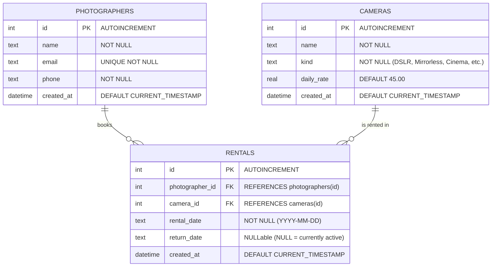

# LensLab Studio — Camera Rental Backend API

[](https://github.com)
[-green.svg)](https://github.com)
[](https://github.com)
[](https://github.com)

Backend REST API for **LensLab Studio**, a professional camera rental management system developed for the **Backend Development Fundamentals (BDF)** Group Assignment (Modules 1 to 3 · 100 Marks).

---

## 📌 Client Brief & Problem Statement

> *"Our cameras are lent by phone call. Two photographers turned up for the same camera on the same day. Please build us a system that fixes this."*
>
> — **LensLab Studio Client Brief** (Theme 5 of 30 · Card 305 of 375)

### How Our System Fixes This:
1. **Automated Inventory & Conflict Prevention**: Before any rental is created via `POST /rentals`, the system checks whether the requested camera is currently out on an active rental (`return_date IS NULL`).
2. **Double-Booking Shield (HTTP 409 Conflict)**: If a camera is already rented out and not yet returned, the server immediately rejects duplicate bookings with an informative HTTP `409 Conflict` response.
3. **Formal Return Lifecycle ("Your Twist")**: Cameras can only be re-rented once officially checked back into inventory via `POST /rentals/:id/return`.

---

## 🏗️ System Architecture & Tech Stack

- **Runtime**: [Node.js](https://nodejs.org/) (v18+)
- **Framework**: [Express.js](https://expressjs.com/) (v4.x)
- **Database**: [SQLite3](https://www.sqlite.org/) (Embedded relational database with `PRAGMA foreign_keys = ON`)
- **Testing**: Node.js built-in test runner (`node:test`, `node:assert/strict`) & [Supertest](https://github.com/ladjs/supertest)
- **API Testing**: Postman Collection v2.1.0 (`LensLab_Studio.postman_collection.json`)

```
GROUP ASS BDF/
├── LensLab_Studio.postman_collection.json # Complete Postman test collection
├── package.json                          # Dependencies and lifecycle scripts
├── README.md                             # Project documentation & Demo Day Q&A
├── src/
│   ├── app.js                            # Express application setup & middleware
│   ├── server.js                         # Server entry point & DB bootstrap
│   ├── database/
│   │   ├── db.js                         # SQLite connection & schema initialization
│   │   └── seed.js                       # Database seeder with realistic records
│   ├── middleware/
│   │   ├── validation.js                 # Input validation middleware
│   │   └── errorHandler.js               # Centralized error & 404 handlers
│   └── routes/
│       ├── cameras.js                    # Camera CRUD & Query Search (/cameras)
│       ├── photographers.js              # Photographers & History (/photographers)
│       └── rentals.js                    # Rentals, Join & Return Flow (/rentals)
└── tests/
    └── api.test.js                       # 19 automated tests (including Twist 1, 2, 3)
```

---

## 🗄️ Database Design & Schema

The relational database consists of **3 related tables** with foreign key constraints enabled:



---

## ⚡ API Endpoints Reference

### 1. Cameras (`/cameras`) — CRUD, Validation & Query Search

| Method | Endpoint | Description | Status Code | Query Params / Body |
| :--- | :--- | :--- | :--- | :--- |
| **GET** | `/cameras` | Retrieve all cameras | `200 OK` | Optional `?kind=DSLR` or `?name=Sony` |
| **GET** | `/cameras?kind=...` | **Search by query parameter** (e.g. `kind=Mirrorless`) | `200 OK` | `kind` (case-insensitive filter) |
| **GET** | `/cameras/:id` | Get single camera by ID | `200 OK` / `404 Not Found` | URL parameter `:id` |
| **POST** | `/cameras` | Add new camera (validates name & kind) | `201 Created` / `400 Bad Request` | Body: `{ "name": "...", "kind": "..." }` |
| **PUT** | `/cameras/:id` | Update camera details | `200 OK` / `400 Bad Request` / `404` | Body: `{ "name": "...", "kind": "..." }` |
| **DELETE** | `/cameras/:id` | Remove camera from inventory | `200 OK` / `404 Not Found` | URL parameter `:id` |

### 2. Photographers (`/photographers`)

| Method | Endpoint | Description | Status Code | Query Params / Body |
| :--- | :--- | :--- | :--- | :--- |
| **GET** | `/photographers` | List all photographers | `200 OK` | None |
| **GET** | `/photographers/:id` | Get single photographer by ID | `200 OK` / `404 Not Found` | URL parameter `:id` |
| **POST** | `/photographers` | Add photographer (validates name, email, phone) | `201 Created` / `400 Bad Request` | Body: `{ "name": "...", "email": "...", "phone": "..." }` |
| **PUT** | `/photographers/:id` | Update photographer details | `200 OK` / `400` / `404` | Body: `{ "name": "...", "email": "...", "phone": "..." }` |
| **DELETE** | `/photographers/:id` | Delete photographer record | `200 OK` / `404 Not Found` | URL parameter `:id` |

### 3. Rentals (`/rentals`) & Join Endpoint

| Method | Endpoint | Description | Status Code | Query Params / Body |
| :--- | :--- | :--- | :--- | :--- |
| **GET** | `/rentals` | List all rentals joined with photographer & camera names | `200 OK` | Optional `?active=true` / `?photographer_id=1` |
| **GET** | `/rentals/details` | **Explicit JOIN endpoint**: Rentals with photographer & camera names | `200 OK` | None |
| **GET** | `/rentals/:id` | Get single rental with joined photographer & camera info | `200 OK` / `404 Not Found` | URL parameter `:id` |
| **POST** | `/rentals` | Rent a camera (checks existence & prevents double-booking) | `201 Created` / `400` / `404` / `409` | Body: `{ "photographer_id": 1, "camera_id": 2, "rental_date": "2026-11-10" }` |
| **DELETE** | `/rentals/:id` | Remove rental record | `200 OK` / `404 Not Found` | URL parameter `:id` |

---

## 🎯 Your Twist: Return Flow

The client requested a return tracking system with duplicate prevention and history reporting:

### Rules:
1. `POST /rentals/:id/return` sets a `return_date` (defaults to current timestamp/date).
2. Returning twice gets **HTTP 409 Conflict** and the exact message: `"Already returned"`.
3. `GET /photographers/:id/history` lists all returned rentals for that photographer with camera details.

### Twist Verification Matrix:

| Test | Action | Method & Endpoint | Expected Status | Result |
| :---: | :--- | :--- | :---: | :---: |
| **Test 1** | Return an active rental | `POST /rentals/1/return` | **200 OK** | Sets `return_date`, returns rental object |
| **Test 2** | Return the same rental again | `POST /rentals/1/return` | **409 Conflict** | Error message: `"Already returned"` |
| **Test 3** | List photographer's returned history | `GET /photographers/1/history` | **200 OK** | Lists photographer's returned rentals |

---

## 🚀 Setup & Execution Guide

### 1. Prerequisites
- [Node.js](https://nodejs.org/) (version 18 or above recommended)
- [npm](https://www.npmjs.com/) (bundled with Node.js)

### 2. Installation
Clone or navigate to the project directory and install dependencies:
```bash
npm install
```

### 3. Initialize & Seed Database
Populate SQLite with sample photographers, cameras, and rentals:
```bash
npm run seed
```
*Creates `lenslab.db` with 4 photographers, 6 cameras across multiple kinds, and active/returned rentals.*

### 4. Start the Server
- **Production mode**:
  ```bash
  npm start
  ```
- **Development mode** (auto-reloads on file change):
  ```bash
  npm run dev
  ```
The API server will listen on `http://localhost:3000`.

### 5. Run Automated Test Suite
To execute all 19 automated unit & integration tests:
```bash
npm test
```
*Output:*
```
✔ LensLab Studio API Test Suite (335.927ms)
ℹ tests 19
ℹ suites 6
ℹ pass 19
ℹ fail 0
```

---

## 📮 Postman Collection Instructions

The file `LensLab_Studio.postman_collection.json` contains a pre-configured collection covering every requirement.

### How to Import & Run:
1. Open **Postman**.
2. Click **Import** (top left) and select `LensLab_Studio.postman_collection.json`.
3. Ensure the server is running on `http://localhost:3000`.
4. Run requests individually or run the entire folder via **Run Collection**:
   - `00. System & Health`
   - `01. Cameras (CRUD, Validation, Search)`
   - `02. Photographers`
   - `03. Rentals & Join Endpoint`
   - `04. Twist: Return Flow (Tests 1, 2, 3)` *(Every request includes automated post-response test assertions!)*

---

## 👥 Group Member Responsibilities (Parts 1 to 6)

According to the Client Brief specification, the project is structured into 6 individual roles:

| Part | Member Role | Primary Code Files | Responsibilities |
| :---: | :--- | :--- | :--- |
| **1** | **Server and routes** | `src/app.js`, `src/server.js` | Express app configuration, body parsers, CORS headers, route mounting, centralized 404 & error handling, correct HTTP status codes. |
| **2** | **Database** | `src/database/db.js`, `src/database/seed.js` | Schema design for 3 related tables (`photographers`, `cameras`, `rentals`), foreign key constraints, async Promise wrappers, seed data script. |
| **3** | **REST endpoints** | `src/routes/cameras.js`, `src/routes/rentals.js`, `src/routes/photographers.js` | Full CRUD operations for cameras and photographers, and the SQL `JOIN` endpoint linking rentals with photographer & camera names. |
| **4** | **Validation and search** | `src/middleware/validation.js`, `src/routes/cameras.js` | Request body validation with clear error messages (400 Bad Request), query parameter filtering (`GET /cameras?kind=...`). |
| **5** | **Twist rule** | `src/routes/rentals.js`, `src/routes/photographers.js`, `tests/api.test.js` | Implemented return flow, duplicate return check with 409 Conflict ("Already returned"), photographer history route, automated tests 1, 2, 3. |
| **6** | **Postman and README** | `LensLab_Studio.postman_collection.json`, `README.md` | Postman collection with test assertions, system documentation, API guide, and demo presentation prep. |

---

## 🎤 Demo Day Guide (Mon 16 Nov — 3-Minute Live Demo)

### 3-Minute Live Demo Script:
1. **Minute 0:00 - 0:45 (Introduction & Core Fix)**:
   - Introduce LensLab Studio (ST-CSE2D-G05).
   - Show `GET /cameras` and `GET /cameras?kind=Mirrorless` (Search by query parameter).
   - Explain how `POST /rentals` prevents two photographers from booking the same camera on the same day.
2. **Minute 0:45 - 1:45 (CRUD, Join Endpoint & Validation)**:
   - Run `POST /cameras` with missing kind to show 400 validation error message.
   - Run `GET /rentals/details` to show the SQL `JOIN` returning both photographer name and camera name.
3. **Minute 1:45 - 3:00 (The Twist Flow: Tests 1, 2, 3)**:
   - **Test 1**: Execute `POST /rentals/1/return` -> Returns `200 OK` and sets return date.
   - **Test 2**: Execute `POST /rentals/1/return` again -> Returns `409 Conflict` with `"Already returned"`.
   - **Test 3**: Execute `GET /photographers/1/history` -> Returns `200 OK` with the returned rental in history!

---

### Potential Demo Questions & Answers by Part:

#### Member 1 (Server and routes):
- **Q**: *How is Express configured and how do you ensure non-existent routes return 404?*
- **A**: "We use `express.json()` to parse payloads, configure CORS headers, and register modular routers. At the bottom of `src/app.js`, after all route declarations, we mount `notFoundHandler` which catches all unhandled requests and returns HTTP 404 with a structured JSON message."

#### Member 2 (Database):
- **Q**: *How are relationships modeled and how is data integrity enforced in SQLite?*
- **A**: "We enabled `PRAGMA foreign_keys = ON;`. The `rentals` table holds foreign keys `photographer_id` and `camera_id` referencing their respective primary keys with `ON DELETE CASCADE`. All SQLite callbacks are wrapped in Promises for clean async/await queries without callback hell."

#### Member 3 (REST endpoints):
- **Q**: *How does your JOIN endpoint work?*
- **A**: "In `GET /rentals/details`, we perform an inner join between `rentals`, `photographers`, and `cameras`. This allows the response to return the rental details alongside `photographers.name AS photographer_name` and `cameras.name AS camera_name` in a single query."

#### Member 4 (Validation and search):
- **Q**: *How does the query parameter search work and what happens if someone submits invalid data?*
- **A**: "In `GET /cameras`, we read `req.query.kind`. If supplied, we append `AND LOWER(kind) = LOWER(?)` to the SQL query. For validation, our `validateCameraCreate` middleware verifies non-empty strings; if validation fails, it halts the request with HTTP 400 Bad Request and a descriptive error message."

#### Member 5 (Twist rule):
- **Q**: *How did you implement the return flow and ensure returning twice returns 409?*
- **A**: "In `POST /rentals/:id/return`, we first fetch the rental. If `return_date` is not null, we immediately return status 409 with `{ "error": "Already returned", "message": "Already returned" }`. If null, we set `return_date` to the current date, save it, and return 200. The history endpoint queries `WHERE photographer_id = ? AND return_date IS NOT NULL`."

#### Member 6 (Postman and README):
- **Q**: *How are tests automated inside Postman?*
- **A**: "In the Postman collection under the **Tests** tab of each request, we use `pm.test()` and `pm.expect()` assertions verifying status codes (200, 201, 400, 404, 409) and verifying response JSON properties such as `already returned` and history contents."

